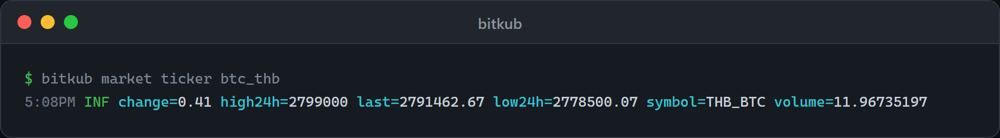
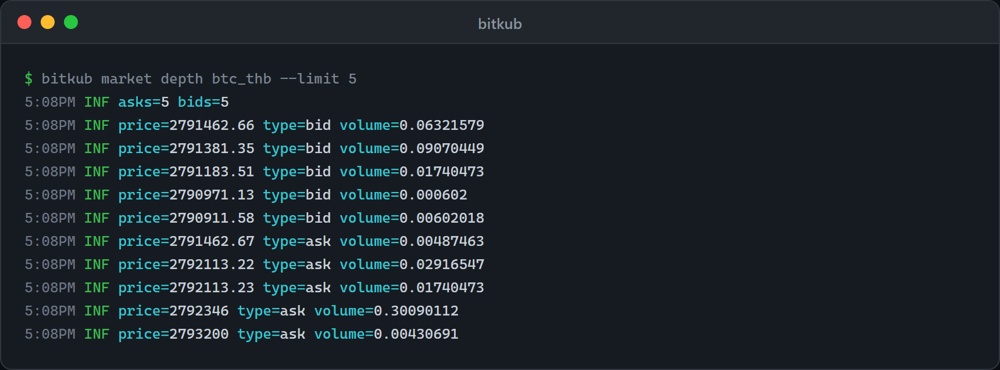
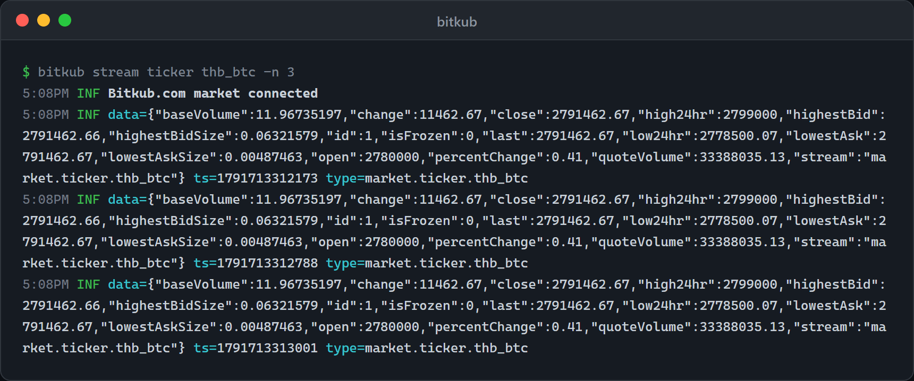
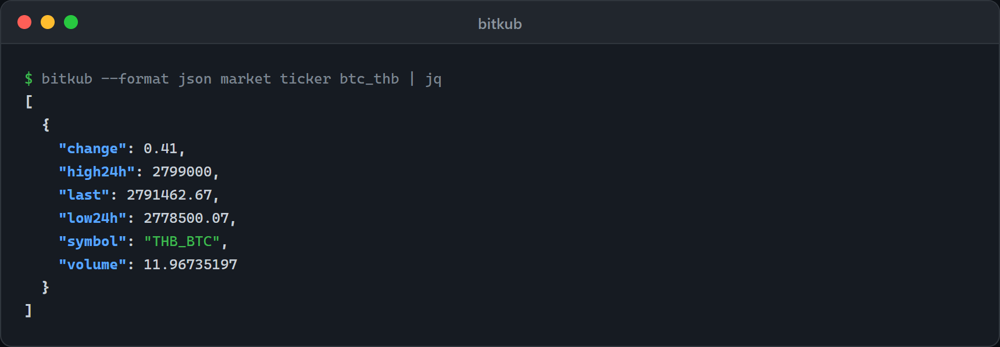

<div align="center">

# go-bitkub

**Bitkub's whole API in one Go module, plus a CLI you can use in 30 seconds.**

Check Thai baht crypto prices, stream live tickers and manage your Bitkub account from Go code or your terminal. No hand-rolled HMAC signing, no server-time drift bugs, no API key needed for market data.

[](https://github.com/dvgamerr-app/go-bitkub/stargazers)
[](https://github.com/dvgamerr-app/go-bitkub/releases/latest)
[](https://pkg.go.dev/github.com/dvgamerr-app/go-bitkub)
[](LICENSE)
[](https://github.com/dvgamerr-app/go-bitkub/releases/latest)

[Website](https://dvgamerr-app.github.io/go-bitkub/) · [Quick start](#quick-start) · [Install guide](INSTALL.md) · [CLI reference](CLI.md) · [ภาษาไทย](README.th.md)

  

**If go-bitkub saves you an afternoon of reading exchange docs, please [give it a ⭐](https://github.com/dvgamerr-app/go-bitkub/stargazers). It helps other Thai crypto developers find it.**

</div>

## Why go-bitkub

- **One import for every Bitkub API.** Market V3, Crypto V4, fiat, user and the WebSocket stream share one client, one error type and one set of credentials.
- **Market data without an account.** Public commands and functions never ask for keys, never sign and never call the server-time endpoint.
- **Authentication done right.** Secure calls sync Bitkub's server time once, sign with HMAC-SHA256 and send `X-BTK-TIMESTAMP`, `X-BTK-APIKEY` and `X-BTK-SIGN` for you. Missing keys fail fast with a clear message instead of an HTTP 400.
- **Script-friendly CLI.** Every command prints readable logs, a JSON array or JSON Lines, so it drops straight into `jq`, cron jobs and dashboards.

## Features

| | Feature | What you get |
|---|---|---|
| 📈 | **Market data** | Symbols, ticker, depth, bids, asks, recent trades and TradingView candles. |
| 🔴 | **Live streams** | WebSocket trade, ticker and order-book streams with auto-reconnect. |
| 🧾 | **Trading** | Place, cancel and look up buy and sell orders, open orders and order history. |
| 💰 | **Balances** | Wallet and detailed balances, including reserved amounts. |
| 🪙 | **Crypto V4** | Deposit addresses, deposits, withdrawals, coins and networks, compensations. |
| 🏦 | **Fiat** | Bank accounts, THB deposit and withdrawal history, THB withdrawals. |
| 👤 | **User** | Trading limits, trading credits and coin-convert history. |
| 🖥️ | **33 CLI commands** | Every SDK feature from the terminal, 9 of them work without API keys. |
| 🧩 | **Three output formats** | `--format text`, `json` or `jsonl` on every command. |
| 📦 | **Prebuilt binaries** | Linux, macOS and Windows on amd64 and arm64 (Windows amd64 only). |

<details>
<summary><b>More screenshots</b></summary>

<br>

`bitkub --format json market ticker btc_thb | jq`



`bitkub market depth btc_thb --limit 5`


`bitkub stream ticker thb_btc -n 3`


</details>

## Quick start

### 1. Install the CLI

With Go 1.26 or newer:

```bash
go install github.com/dvgamerr-app/go-bitkub/cmd/bitkub@latest
```

Without Go, download a prebuilt binary (Linux x86_64 shown; use `Darwin_arm64`, `Darwin_x86_64` or `Linux_arm64` for other machines):

```bash
curl -fsSL https://github.com/dvgamerr-app/go-bitkub/releases/latest/download/go-bitkub_Linux_x86_64.tar.gz | tar -xz bitkub
sudo mv bitkub /usr/local/bin/
```

On Windows, download `go-bitkub_Windows_x86_64.zip` from the [latest release](https://github.com/dvgamerr-app/go-bitkub/releases/latest) and put `bitkub.exe` on your `PATH`.

### 2. Read the market (no keys needed)

```bash
bitkub market ticker btc_thb
bitkub market depth btc_thb --limit 5
bitkub stream ticker thb_btc -n 3
```

### 3. Connect your account (optional)

Create an API key in Bitkub's API management page, then either export it or put it in a `.env` file in the directory you run `bitkub` from:

```bash
export BTK_APIKEY=REPLACE_ME
export BTK_SECRET=REPLACE_ME

bitkub market balances
bitkub market open-orders btc_thb
```

You can also pass `--key` and `--secret` on any command. The [install guide](INSTALL.md) covers `PATH` setup, updates and uninstalling.

## Use it from Go

```bash
go get github.com/dvgamerr-app/go-bitkub
```

```go
package main

import (
	"fmt"
	"log"

	"github.com/dvgamerr-app/go-bitkub/bitkub"
	"github.com/dvgamerr-app/go-bitkub/market"
	"github.com/dvgamerr-app/go-bitkub/stream"
)

func main() {
	tickers, err := market.GetTicker("btc_thb")
	if err != nil {
		log.Fatal(err)
	}
	fmt.Printf("BTC/THB %.2f (%+.2f%%)\n", tickers[0].Last, tickers[0].PercentChange)

	if err := bitkub.Initlizer(); err == nil {
		balances, err := market.GetBalances()
		if err != nil {
			log.Fatal(err)
		}
		fmt.Println("THB available:", balances["THB"].Available)
	}

	s := stream.New(nil)
	if err := s.ConnectMarket("market.ticker.thb_btc"); err != nil {
		log.Fatal(err)
	}
	defer s.Close()

	for msg := range s.Messages() {
		fmt.Println(msg.Type, msg.Data)
	}
}
```

`bitkub.Initlizer()` reads `BTK_APIKEY` and `BTK_SECRET` from the environment, or takes them as two arguments. The [SDK reference](docs/reference.md) lists every function with an example.

## Architecture

```
  your Go app ─┐                    ┌─ https://api.bitkub.com/api/v3/*   market, trading, fiat, user
               ├─▶ go-bitkub SDK ───┼─ https://api.bitkub.com/api/v4/*   crypto deposits and withdrawals
  bitkub CLI ──┘   (bitkub/fetch)   └─ wss://api.bitkub.com/websocket-api   live streams
```

Go 1.26 with the standard `net/http` client, `gorilla/websocket` for streams, Cobra for the CLI and zerolog for output.

## Documentation

- [Install guide](INSTALL.md): every install method, configuration, updating and uninstalling.
- [CLI reference](CLI.md): every command and flag with examples.
- [SDK reference](docs/reference.md): every Go function, rate limits and security notes.
- [Stream guide](stream/README.md): WebSocket streams, reconnect settings and order books.
- [Official Bitkub API docs](https://github.com/bitkub/bitkub-official-api-docs).

## Develop

```bash
git clone https://github.com/dvgamerr-app/go-bitkub.git
cd go-bitkub
go test ./...          # unit tests plus live WebSocket smoke tests
go vet ./...
go build ./...
go test -tags=integration ./...   # hits live Bitkub REST APIs, needs BTK_APIKEY and BTK_SECRET
```

## Support the project

- ⭐ [Star the repository](https://github.com/dvgamerr-app/go-bitkub/stargazers) so more developers find it.
- 🐛 [Report a bug or request an endpoint](https://github.com/dvgamerr-app/go-bitkub/issues).
- 💬 [Join the Discord](https://discord.gg/QDccF497Mw).

[](https://star-history.com/#dvgamerr-app/go-bitkub&Date)

## Licence

[MIT](LICENSE). go-bitkub is an unofficial project and is not affiliated with or endorsed by Bitkub. Trading crypto carries risk; test with small amounts first.
